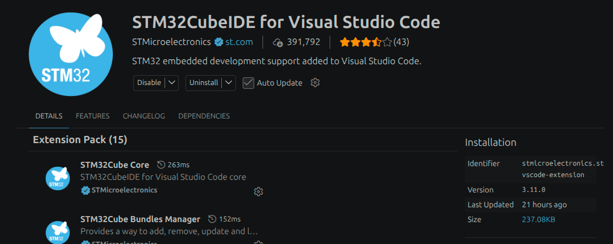
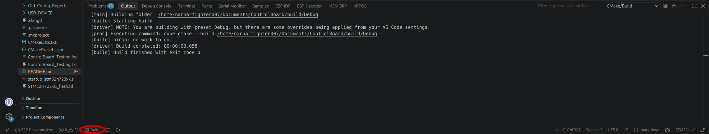
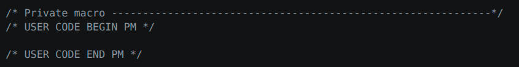
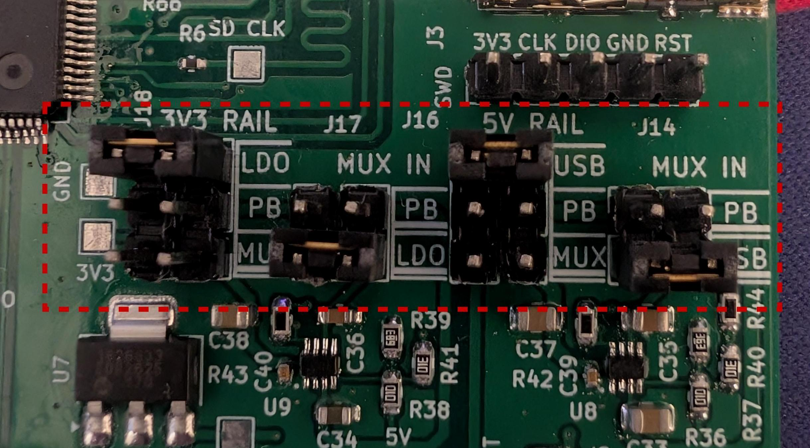
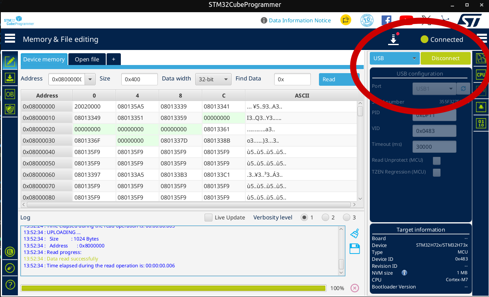
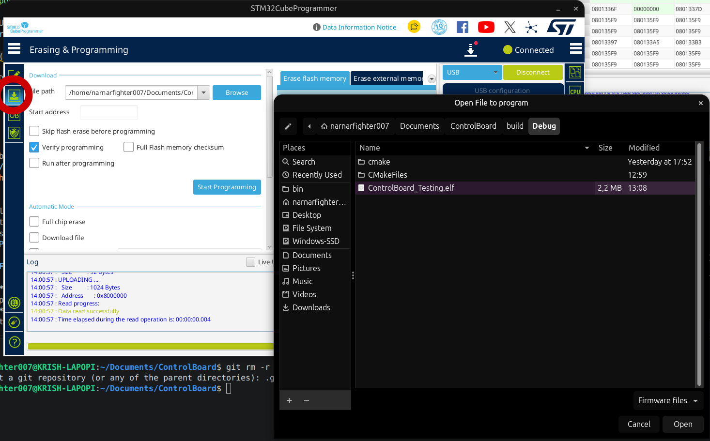
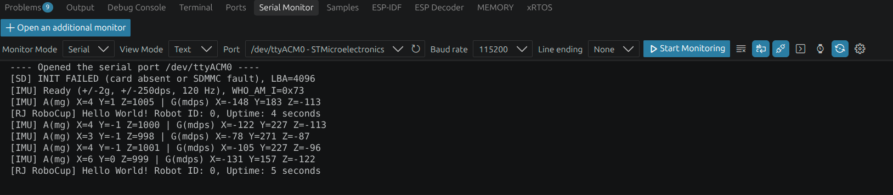

# RoboJackets RoboCup — 2027 Firmware

Firmware bring-up and peripheral testing for the **RoboJackets RoboCup Small Size League (SSL)** autonomous soccer robots. See `/docs` for the hardware reference manuals and STM32CubeMX pin-out reports. 

> [!WARNING]
> **Early hardware proof of concept — not competition-ready firmware.**
> The code currently being pushed is intentionally quick, experimental, and sometimes messy. Its purpose is to confirm that the newly assembled 2027 control board's electrical interfaces and peripherals work. It is **not** a production architecture, a complete robot controller, or a formal automated unit-test suite. Expect blocking HAL calls, temporary diagnostics, and test logic living together in `main.c`. We will refactor after hardware bring-up.

> [!NOTE]
> Please slack message Krish Shajpaul if this guide is inadequate and you need help (or do yourself :D). This guide is useful for all the new STM32 boards we have, but is focused on the 2027 Control Board specifically.

## Hardware

The **ControlBoard2027** is based on an **STM32H723ZGT6 (Cortex-M7)** and interfaces with a separate **RadioBoard2027** built around an **ESP32-C5-WROOM-1U-N8R8**. The radio board is intended to provide 2.4/5 GHz Wi-Fi via ESP-Hosted over SPI; this integration has **not yet been verified**.

The board uses a **25 MHz HSE crystal**. The current CubeMX clock plan targets a **240 MHz system clock** and a **48 MHz USB/SDMMC kernel clock**. Firmware uses STM32 HAL, with **no FreeRTOS** during initial bring-up.

| Interface | MCU pins / connection | Hardware |
| --- | --- | --- |
| USB device (USB_OTG_HS, internal full-speed PHY) | PA11 D−, PA12 D+, PA9 VBUS GPIO | USB-C, DFU programming and CDC serial |
| SPI1 | PA5 SCK, PA6 MISO, PA7 MOSI; PC5/PB0/PB1/PB2/PF11 CS | Four motor modules and dribbler |
| SPI2 (TX only) | PB13 SCK, PB15 MOSI | Five RGB/DotStar LEDs |
| SPI3 | PB3 SCK, PB4 MISO, PD6 MOSI; PB5 CS, PB6 HANDSHAKE, PB7 DATA_READY, PE1 RESET | ESP32-C5 radio daughterboard |
| I2C1 | PB8 SCL, PB9 SDA | SSD1306 128×64 OLED |
| I2C2 | PB10 SCL, PB11 SDA | Kicker board |
| I2C4 | PF14 SCL, PF15 SDA | Two expansion connectors (shared bus) |
| I2C5 | PF1 SCL, PF0 SDA; PF3/PF2 interrupt inputs | LSM6DSV320X IMU at 7-bit address `0x6A` |
| SDMMC1 | PC8–PC11 D0–D3, PC12 CK, PD2 CMD | microSD socket, 4-bit bus |
| UART4 | PA0 TX, PA1 RX | Powerboard communication |
| Buttons | PE4, PC13, PC14 | Three active-low user buttons (EXTI) |
| Robot ID DIP | PF7–PF10, PC0–PC1 | Six active-low switches, sampled at startup |
| Power-source sense | PA2, PA3 | Powerboard-supplied 5 V / 3.3 V status |
| SWD | PA13 SWDIO, PA14 SWCLK, NRST | External debugger/programmer header |

**Hardware source of truth:** The final schematics take precedence over planning documents. The firmware-facing specifications are `ControlBoard2027_SPEC.md` and `RadioBoard2027_SPEC.md` (add them under `Control_Board/docs/` if they are not yet in this repository). Earlier CubeMX/test planning PDFs may have outdated pin assignments.

## Bring-up status

_Status as of October 26, 2026. “Implemented” does not mean electrically validated._

| Test / interface | Status | Notes |
| --- | --- | --- |
| USB-C ROM DFU programming | **Verified** | STM32CubeProgrammer programmed and verified firmware through the board's USB-C port without ST-LINK |
| USB CDC virtual serial port | **Verified** | Linux enumerates `/dev/ttyACM0`; periodic Hello World messages received |
| SPI2 RGB LED chain | **Verified** | Basic LED output/blinking works; test patterns are not a production current-management implementation |
| I2C1 OLED | **Verified** | SSD1306 test message rendered |
| Three user buttons / EXTI | **Verified** | Button events received in USB serial monitor |
| Six-bit robot ID DIP | **Verified** | Read once after GPIO initialization; latched until MCU reset |
| I2C5 IMU | **Verified** | WHO_AM_I and live low-g accelerometer/gyroscope reporting planned; actual output not yet confirmed |
| SDMMC1 / microSD | **Under investigation — not working yet** | Card initialization fails around CMD55; see below |
| SPI3 / ESP-Hosted / Wi-Fi | **Not tested** | Includes radio board link and wireless communication |
| Board-to-board interfaces | **Not tested** | Motor/dribbler SPI1, kicker I2C2, powerboard UART4, expansion I2C4 |
| Power-source switching / recovery | **Not tested** | Requires controlled bench validation |

### Known SDMMC issue

SDMMC1 is configured for a 4-bit bus with a 48 MHz kernel clock (24 MHz target transfer clock). The board has **no card-detect GPIO** and **no SD card power switch**. FatFs was disabled for initial HAL-level testing.

SD initialization has failed in both 1-bit and 4-bit configurations. Diagnostic observations:

```text
HAL_SD_Init() -> HAL_ERROR
Originally reported: HAL_SD_ERROR_UNSUPPORTED_FEATURE (0x10000000)
After temporary HAL diagnostic change: 0x00000001 (command CRC failure)
Last command recorded: CMD55
SDMMC kernel clock reported: 48000000 Hz
```

Further investigation is happening. Priority checks: microSD socket 3.3 V, card seating/soldering, SD clock at TP1, CMD-line activity, and generated SDMMC MSP GPIO/clock setup. **Do not interpret the CRC error alone as proof of a hardware defect.** Revert any temporary modifications to ST HAL driver source after diagnosis.

**Keep raw SD writes disabled during debugging.** Raw-sector tests can overwrite filesystem data; use only a disposable card with backups when write testing is deliberately enabled. No successful SD read/write verification has been reported yet.

## Development environment / Setup Guide

- **MCU:** STM32H723ZGT6
- **Configuration/code generation:** STM32CubeMX (`ControlBoard_Testing.ioc`)
- **Firmware package used for initial generation:** STM32Cube FW_H7 **V1.13.0**
- **Build system:** CMake + Ninja, targeting Arm GNU Toolchain (`arm-none-eabi-gcc`)
- **Editor:** Visual Studio Code, with ST's STM32CubeIDE/STM32 tooling extension
- **Programming:** STM32CubeProgrammer over USB DFU; optional external ST-LINK over SWD

> Follow this short video guide for setting up a new STM project: [Get started with STM32Cube for VS Code](https://www.youtube.com/watch?v=aWMni01XGeI&t=112s).

### What you should install
- **STM32CubeProgrammer** ([Download Link](https://www.st.com/en/development-tools/stm32cubeprog.html#get-software))
   - For uploading your firmware onto the board.
- **STM32CubeMX** ([Download Link](https://www.st.com/en/development-tools/stm32cubemx.html))
   - For setting up pin configurations, clock frequencies, communication speeds, and middleware. Super helpful for finding pin conflicts or if the STM chip you have chosen has everything you need. 
   - Generates all the annoying pin configuration code in firmware for you.
   - We are using just STM32CubeMX, not STM32CubeMX2  
   - Please use **the guide linked above** if you want more information about setting your STM chip for firmware development.
- **STM32CubeIDE for Visual Studio Code**
   - VSCode Extension that allows us to compile STM firmware binaries right on VSCode.
   - Make sure you install the bundle, not just the Core, Debugger, etc.


### Clone and build

1. Install CMake, Ninja, an Arm embedded GCC toolchain, and the ST tools/extensions above. The team should use compatible toolchain and Cube firmware-package versions when regenerating the project.
> [!TIP]
> You should be prompted to install CMake, Ninja, and embedded GCC when opening your first project.

> [!WARNING]
> If you want the STM32 VSCode Extension to detect your project, make sure the `CMakeLists.txt` file is in the root of your VSCode workspace.

```bash
git clone https://github.com/RoboJackets/robocup-firmware.git
cd robocup-firmware

# Available presets are listed in CMakePresets.json.
cmake --list-presets
cmake --preset Debug
cmake --build build/Debug
```

3. When the STM32 VSCode extension is done loading with your project, you will see a "build" button on the bottom left. This is used to compile your code and output an ELF (compiled binary) similar to `build/Debug/ControlBoard_Testing.elf`. The exact output path may change with the preset or project name.


<p style="text-align: center;">
   Successful build: <code>exit code 0</code>; the ELF is written to <code>build/Debug</code>.
</p>

> [!Tip]
> The .elf is a binary file that contains ARM Cortex-M7 firmware; it must be programmed onto the STM32. A successful build is not proof that the firmware works on hardware.

### Where to Write Code

STM32CubeMX code (when not using RTOS) is structured kind of similar to a classic `setup()` and `while(1)` loop you set in Arduino. You `main.c` file is located in `Core/Src/main.c`.

**HOWEVER**, there are some annoying caveats (more to be added when others find STM development quirks):

#### Caveat #1: You can only write code in defined `USER CODE` sections.
There are explicit sections in the code where you can actually write code in the `Core/Src` folder (which is where pretty much all your code will be written). Wherever you see a ``/* USER CODE BEGIN ...*/``, you can write code up until you see a ``/* USER CODE END ... */``. Each user code section is for specific types of code (includes, private variables, hardware interrupt handlers, etc.). Look through `main.c` to find where you should put your code.


<p style="text-align: center;">
   Example of user code sections in <code>main.c</code>. In this example section, should only put private macros here.
</p>

> [!WARNING]
> If you write code outside these sections, the compiler either yell at you or silently overwrite your code. If you generate new project code via STM32CubeMX, you *will* get your code replaced if not in user sections.

> [!WARNING]
> Do NOT delete the generated `/* USER CODE BEGIN ... */` and ``/* USER CODE END ...*/`` comments! The STM toolchain (compiler, STM32CubeMX, etc.) uses these comments to distinguish what is user code and what is pre-generated code.

#### Caveat #2: Pretty much only use the Debug preset.

When you first open the project, the STM32 VSCode extension will ask if you development in "Release
or "Debug" mode. Almost always select Debug mode, even if it is intended for deployed firmware.

#### Caveat #3: You will have to configure the CMake files yourself.

Sorry guys :\\. when we start making driver files for peripherals, you are going to have to add it to the CMake in a specific way. When making drivers, please put them in the `Core` folder, with headers in `Core/Inc` and the actual C code in `Core/Src`. I usually use an LLM to configure the CMake files so I'm not gonna be to helpful if you have trouble with this.

## Programming over USB-C (DFU)

1. Verify the control board's power jumpers and use a data-capable USB-C cable. **ENSURE THERE IS ONLY ONCE POWER SOURCE TO THE BOARD AT ALL TIMES (FOR NOW).** This means when USB is connected, only USB power should be connected to the Control Board (Radio daughterboard power MUX has not been verified). No external power like batteries should be on the lines.

For now, the jumpers should be arranged as so for USB power:


> [!WARNING]
> JTAG has a direct line to 3V3, fully bypassing power circuitry. **PLEASE** ensure this is the only 3V3 being supplied when used (so no USB & JTAG at the same time atm).

2. Hold **BOOT0**, press and release **RESET**, then release **BOOT0** to enter the STM32 ROM DFU bootloader.
3. Confirm your computer sees the DFU device. Windows should check Device Manager. On Linux:

   ```bash
   lsusb -d 0483:df11
   dfu-util -l -d 0483:df11
   ```

4. Open **STM32CubeProgrammer**, change the connection interface from **ST-LINK** to **USB**, and connect to the detected DFU port.



> [!NOTE]
> The STM will not show up as a connectable device unless it is in bootmode. Select the port dropdown to select the USB port.

5. Under **Erasing & Programming**, select the built `.elf`, enable **Verify programming**, and start programming. Confirm the log reports **Download verified successfully**.



6. Disconnect from CubeProgrammer and press RESET (maybe a few times) to boot the application on the STM board.

> [!TIP]
> The DFU bootloader is **not** the USB serial monitor. The application must boot and enumerate its own CDC interface.

### USB serial monitor

Now use your favorite serial monitor tool set to 115200 baude and you should see the STM outputting to the serial monitor with your new firmware!



## Firmware and hardware notes

- **No RTOS yet:** initial smoke tests use blocking HAL calls and the main loop. These are **not** comprehensive software unit tests.
- **USB:** The board uses USB_OTG_HS with its **internal full-speed PHY**. Hardware VBUS sensing must be **disabled**; PA9 is a GPIO used for software-controlled USB connect/disconnect. A valid 48 MHz USB clock is required.
- **Clock/power:** The current 240 MHz AHB/AXI clock plan requires **VOS0** with internal LDO supply. Check generated initialization after CubeMX regeneration.
- **GPIO safety:** Motor and radio chip selects start **high** (inactive). Radio reset PE1 is **open-drain**, initially released. The six robot-ID DIP switches are active-low; switch ON means bit `1` after inversion.
- **USB-only current budget:** Avoid high radio transmit duty cycles or expansion loads. Keep the LED chain within the board spec's **100 mA USB-only** budget. Please max RGB values to 100.
- **SDMMC:** No card-detect pin; initialization must determine accessibility. DMA requires DMA-accessible memory and correct D-cache handling; bring-up currently uses polling.
- **Powerboard UART:** Do not actively drive UART4 TX when the external powerboard is absent.
- **Code generation:** Preserve additions inside CubeMX `USER CODE` sections. Recheck generated pin states, peripheral initialization order, USB settings, clocks, and any modified vendor HAL code when regenerating.
- **Power jumpers:** Inspect the six shunts and the powerboard cable before applying external power. Never move jumpers while powered; incorrect jumper orientation can short supplies.

## Repository conventions and future work

Commit source code, the `.ioc`, linker/startup files, CMake configuration, required HAL/CMSIS and USB middleware, and hardware documentation. Do **not** commit `build/`, ELF/BIN/HEX outputs, or personal IDE caches. A repository `.gitignore` should cover generated artifacts and local settings.

Suggested focused branches include `test/usb-cdc`, `test/spi2-leds`, `test/i2c1-oled`, `test/gpio-buttons`, `test/gpio-dip`, `test/i2c5-imu`, `test/sdmmc1`, and `test/spi3-radio`. Keep changes isolated where practical, document hardware observations, and use pull requests for review. Prefer preserving a reproducible, working baseline on `main`.

**Next milestones:** confirm DIP/IMU hardware results; finish SDMMC electrical debugging; test SPI3 radio/ESP-Hosted and Wi-Fi; test motor, kicker, powerboard, and expansion board links; validate power-source transitions; then modularize the proof-of-concept test firmware and add automated tests as appropriate. FreeRTOS integration can follow after basic peripheral functionality is established.

## Contributing

RoboJackets firmware contributors: please include the exact board revision, test equipment, build/firmware version, steps to reproduce, and relevant USB logs or measurements in issues and pull requests. A successful build and a passing smoke test on one board should not be generalized to every assembled board without further testing.
